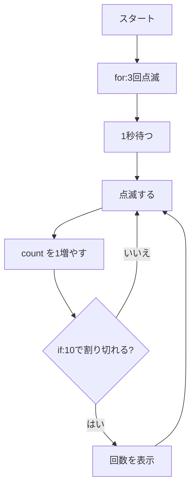

# 01. Python のおさらい(プログラムの制御構造)

## 🎯 このステップのゴール

- プログラムの「動きの流れ」を作る5つの道具(**順次・while・if・for・関数**)が分かる
- `time.sleep()` で待ち時間を作れる
- Pico 本体の LED を点滅させられる

## 🧰 用意するもの

| 部品 | 数 |
|---|---|
| Raspberry Pi Pico(+ USB ケーブル) | 1 |

配線はいらないよ。Pico 本体に付いている LEDを使うよ。

## 📖 知っておきたいこと

### ① 順次:プログラムは上から順に動く

プログラムは **1行ずつ、上から順番に** 実行されるよ。

```python
print("1行目")
print("2行目")   # 1行目のあとに実行される
```

### ② `while True:` 無限ループ

マイコンは「電源が入っている間 **ずっと動き続ける**」のが基本。`while True:` の中は終わらずにくり返されるよ。
止めるには Thonny の **停止ボタン** を押そう。

```python
while True:
    print("ずっと表示")
```

### ③ `if` 条件分岐

「**もし** ボタンが押されていたら」「**もし** 距離が10cm未満なら」のように、条件によって処理を分けるよ。

```python
if distance < 10:
    print("近い!")
else:
    print("遠い")
```

### ④ `for` 繰り返し

**決まった回数** や **決まったもの** を順番に処理するよ。

```python
for i in range(3):     # i に 0, 1, 2 が順に入る
    print(i)
```

### ⑤ 関数 `def`

よく使う処理に **名前を付けて** おく方法。あとのステップで `all_off()`(全部消す)や `read_cm()`(距離を測る)が出てくるよ。
`return` を使うと、関数から結果を返せるよ。

```python
def double(x):
    return x * 2       # x を2倍した結果を返す

print(double(5))       # 10 と表示される
```

### ⑥ `time.sleep()` 待つ命令

| 書き方 | 待つ時間 |
|---|---|
| `time.sleep(1)` | 1秒 |
| `time.sleep_ms(100)` | 100ミリ秒 = 0.1秒 |
| `time.sleep_us(10)` | 10マイクロ秒 = 0.00001秒 |

> 💡 **大事な伏線**:`sleep` で待っている間、Pico は **他のことが何もできない** よ。
> これがあとの「ボタン」や「割り込み」のステップで問題になるので、覚えておこう。

## 🔌 配線

配線はなし。USB でパソコンにつなぐだけだよ。

> 配布したピン配置図で、GP番号と物理ピン番号の両方を確かめよう。(本体LED は外に出ているピンではないので、配線はいらないよ)

## 💻 プログラム

ファイル:[basics.py](basics.py)

下のコードをコピーして Thonny に貼り付け、▶ 実行しよう。

```python
# ---- 必要な道具(モジュール)を読み込む ----
from machine import Pin   # Pin:Pico のピンを操作するための道具
import time               # time:待ち時間を作るための道具

# ---- ピンの設定 ----
# Pico 本体に付いているLEDを出力にする(番号ではなく "LED" と名前で指定する)
led = Pin("LED", Pin.OUT)

# ---- 関数:LEDを1回だけ点滅させる ----
# def で「よく使う処理」に名前を付けておく
def blink():
    led.value(1)           # 1 = 電気を流す = 点灯
    time.sleep_ms(200)     # 200ミリ秒(0.2秒)待つ
    led.value(0)           # 0 = 電気を止める = 消灯
    time.sleep_ms(200)     # 200ミリ秒待つ

# ---- 順次:上から順に1行ずつ実行される ----
print("スタート")

# ---- for:決まった回数だけ繰り返す ----
# range(3) は 0, 1, 2 の3つ。i に順番に入る
for i in range(3):
    print(i + 1, "回目")   # 1回目、2回目、3回目 と表示
    blink()                # 関数を呼び出して1回点滅

time.sleep(1)              # 1秒待つ(この間、Pico は他のことができない)

# ---- while True:ずっと繰り返す(無限ループ) ----
# 止めるときは Thonny の停止ボタンを押す
count = 0                  # 何回点滅したかを数える変数
while True:
    blink()
    count = count + 1      # 1 増やす

    # ---- if:条件によって処理を分ける ----
    # 10回ごとに Shell に表示する
    if count % 10 == 0:    # % は「割った余り」。10で割り切れたら
        print(count, "回点滅しました")
```

## 🔍 プログラムを読み解こう

| 行 | 説明 |
|---|---|
| `led = Pin("LED", Pin.OUT)` | 本体LEDを **出力** にする。番号ではなく **"LED" という名前** で指定する |
| `def blink():` | 「1回点滅する」処理に **関数** として名前を付けた |
| `for i in range(3):` | **for** で 3回くり返す。`i` には 0, 1, 2 が入るので、表示は `i + 1` にしている |
| `time.sleep(1)` | 1秒待つ。この間 Pico は **何もできない** |
| `while True:` | **while** でずっとくり返す(無限ループ) |
| `if count % 10 == 0:` | **if** で「10で割り切れたら」だけ表示する |

全体の流れは、上から順に(**順次**)進んでいくよ。



## ✅ 動作チェック

- [ ] 本体LEDが3回点滅し、Shell に「1 回目」〜「3 回目」と表示された
- [ ] そのあと点滅し続け、10回ごとに「10 回点滅しました」と表示された
- [ ] 停止ボタンで止められた

## 🤔 考えてみよう

1. `for i in range(3):` を `for i in range(5):` にすると何が変わる?

<details>
<summary>答えを見る</summary>

最初の点滅が **5回** になり、「1 回目」〜「5 回目」と表示されるよ。`range(5)` は 0〜4 の5つの数を作るからだね。

</details>

2. `while True:` の中の `blink()` を消すとどうなる?

<details>
<summary>答えを見る</summary>

LED は点滅しなくなり、`count` がものすごい速さで増えていくよ。`blink()` の中の `sleep` がなくなったので、待ち時間がなくなったんだね。Shell が数字であふれるので停止ボタンで止めよう。

</details>

3. `time.sleep(1)` の間にボタンを押したら、Pico は気づけるかな?

<details>
<summary>答えを見る</summary>

**気づけない** よ。`sleep` 中は他のことができないからね。この問題をどう解決するかは [03](../03-button-polling/README.md) と [04](../04-button-irq/README.md) で考えるよ。

</details>

## 🚀 改良チャレンジ

### レベル1:数字を変えてみよう

点滅の速さを **速く** してみよう。

<details>
<summary>ヒントを見る</summary>

`blink()` の中の `time.sleep_ms(200)` の数字を小さくすると速くなるよ。

</details>

<details>
<summary>解答例を見る(まず自分で挑戦してから!)</summary>

[解答例と解説](answers/README.md#lv1) / [lv1.py](answers/lv1.py)

</details>

### レベル2:動きを足してみよう

`blink(3)` と書いたら3回、`blink(5)` と書いたら5回点滅するように、**点滅回数を関数の引数** にしてみよう。

<details>
<summary>ヒントを見る</summary>

`def blink(times):` のように `( )` の中に名前を書くと、呼び出すときに数を渡せるよ。関数の中で `for i in range(times):` を使おう。

</details>

<details>
<summary>解答例を見る(まず自分で挑戦してから!)</summary>

[解答例と解説](answers/README.md#lv2) / [lv2.py](answers/lv2.py)

</details>

### レベル3:自分で考えて作ってみよう

モールス信号の **SOS**(・・・ - - - ・・・)を LED で出してみよう。

<details>
<summary>ヒントを見る</summary>

「点灯の長さ」も引数にした関数 `blink(回数, 点灯ミリ秒)` を作ると、短い光と長い光を簡単に出し分けられるよ。

</details>

<details>
<summary>解答例を見る(まず自分で挑戦してから!)</summary>

[解答例と解説](answers/README.md#lv3) / [lv3.py](answers/lv3.py)

</details>

## ➡️ 次へ

[02. 信号機](../02-traffic-light/README.md)
