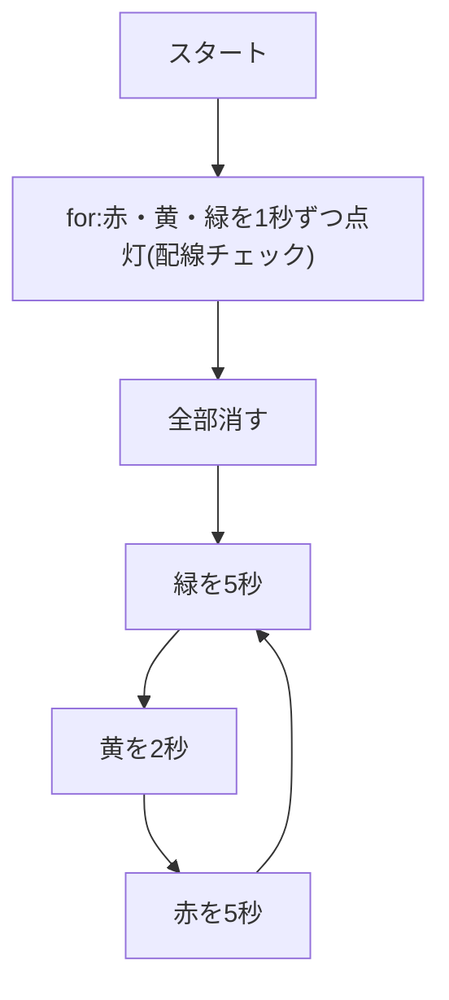

# 02. 信号機を光らせよう

## 🎯 このステップのゴール

- GPIO の **出力** で LED を点けたり消したりできる
- LED に **電流制限抵抗** が必要な理由を、オームの法則で説明できる
- `while True` で信号機のサイクル(緑→黄→赤)を作れる

## 🧰 用意するもの

| 部品 | 数 |
|---|---|
| Raspberry Pi Pico(+ USB ケーブル) | 1 |
| 信号機LEDモジュール(抵抗内蔵) | 1 |
| ジャンパーワイヤ | 4 |

## 📖 知っておきたいこと

### LED は抵抗なしでつないではいけない

- LED は電流(電気の流れの量)が **流れすぎると壊れる** よ。最悪の場合、Pico 側も傷む。
- 電流を抑えるために、**電流制限抵抗** を LED と **直列**(一列につなぐこと)に入れる。
- 単体の LED を光らせるときは、**220Ω 程度の抵抗が必要** だよ。

### 抵抗値の計算(オームの法則)

**オームの法則**:電圧 V = 電流 I × 抵抗 R(→ I = V ÷ R)

LED は光るときに約 **2V** を使う(これを **順方向電圧 Vf** という。赤LEDの目安)。残りの電圧が抵抗にかかるよ。

**① 抵抗にかかる電圧**

| 段階 | 内容 |
|---|---|
| 式 | 抵抗の電圧 = Pico の電圧 − LED の電圧 |
| 数値を入れる | 3.3V − 2.0V |
| 答え | **1.3V** |

**② 流れる電流**

| 段階 | 内容 |
|---|---|
| 式 | 電流 I = 電圧 V ÷ 抵抗 R |
| 数値を入れる | 1.3V ÷ 220Ω |
| 答え | ≒ 0.006A = **6mA** |

6mA なら LED にも Pico にも安全な範囲だよ(LED の目安は 20mA 以下、Pico の GPIO は控えめに使う)。

> 🤔 抵抗なしだと? → 電流を止めるものがなく、**大きな電流が流れてしまう** よ。

### 今回の信号機モジュールは抵抗入り

- 信号機モジュールは基板に **抵抗が組み込まれている** ので、GPIO に直結して OK。
- でも、**部品を単体で使うときは 220Ω を入れる** ことは必ず覚えておこう。

もっと詳しく → [電気の基本まとめ](../docs/electronics-basics.md)

## 🔌 配線

| 信号機の端子 | Pico の GP番号 | 物理ピン番号 |
|---|---|---|
| 赤(R) | GP2 | 4 |
| 黄(Y) | GP3 | 5 |
| 緑(G) | GP4 | 6 |
| GND | GND | 3 |

```
Pico                     信号機モジュール
GP2  (物理4) ─────────── R(赤)
GP3  (物理5) ─────────── Y(黄)
GP4  (物理6) ─────────── G(緑)
GND  (物理3) ─────────── GND
```

> 配布したピン配置図で、GP番号と物理ピン番号の両方を確かめよう。
> ⚠️ 物理3番は **GND** だよ。GP3 ではないので注意!

## 💻 プログラム

ファイル:[traffic_light.py](traffic_light.py)

下のコードをコピーして Thonny に貼り付け、▶ 実行しよう。

<!-- include: traffic_light.py -->
```python
# ---- 必要な道具(モジュール)を読み込む ----
from machine import Pin   # Pin:Pico のピンを操作するための道具
import time               # time:待ち時間を作るための道具

# ---- ピンの設定 ----
# Pin(番号, Pin.OUT) で「このピンは電気を出す(出力)」と決める
red    = Pin(2, Pin.OUT)   # GP2 に赤のLED
yellow = Pin(3, Pin.OUT)   # GP3 に黄のLED
green  = Pin(4, Pin.OUT)   # GP4 に緑のLED

# ---- 関数:全部のLEDを消す ----
def all_off():
    # 赤・黄・緑を1つずつ取り出して p に入れ、順番に消す
    for p in (red, yellow, green):
        p.value(0)         # 0 = 電気を止める = 消灯

# ---- 配線チェック:1個ずつ点灯 ----
# (名前, ピン) の組を順番に取り出して処理する
for name, p in (("赤", red), ("黄", yellow), ("緑", green)):
    all_off()              # いったん全部消す
    print(name, "点灯")    # Shell に今どの色かを表示
    p.value(1)             # 1 = 電気を流す = 点灯
    time.sleep(1)          # 1秒待つ
all_off()                  # チェックが終わったら全部消す

# ---- 信号のサイクル(ずっと繰り返す) ----
while True:                # True なので終わらない(無限ループ)
    green.value(1)         # 緑を点ける
    time.sleep(5)          # 5秒待つ
    green.value(0)         # 緑を消す

    yellow.value(1)        # 黄を点ける
    time.sleep(2)          # 2秒待つ
    yellow.value(0)        # 黄を消す

    red.value(1)           # 赤を点ける
    time.sleep(5)          # 5秒待つ
    red.value(0)           # 赤を消す → また緑に戻る
```

## 🔍 プログラムを読み解こう

| 行 | 説明 |
|---|---|
| `red = Pin(2, Pin.OUT)` | GP2 を **出力** に設定。赤のLEDを操作できるようになる |
| `def all_off():` + `for p in (...)` | **関数** の中で **for** を使って、3つのLEDを順番に消す |
| `for name, p in ((...), ...)` | **for** で1個ずつ点灯 → 配線と色が合っているか確認(配線チェック) |
| `p.value(1)` / `p.value(0)` | 1 で点灯、0 で消灯 |
| `while True:` | **while** で 緑→黄→赤 をずっと繰り返す |



## ✅ 動作チェック

- [ ] 最初に 赤→黄→緑 の順で1秒ずつ点き、Shell に「赤 点灯」などと表示された
- [ ] 表示された色と、実際に光った色が合っている
- [ ] 緑5秒 → 黄2秒 → 赤5秒 をくり返している

## 🤔 考えてみよう

1. 配線チェックで「赤 点灯」と表示されたのに黄が光った。何が原因?

<details>
<summary>答えを見る</summary>

赤と黄の **配線が入れかわっている** よ。GP2 に赤(R)、GP3 に黄(Y)がつながっているか確かめよう。物理ピン番号と GP番号の取り違えもよくある原因だよ。

</details>

2. 単体の LED に 100Ω の抵抗を使ったら、電流は何mA になる?(Vf = 2.0V とする)

<details>
<summary>答えを見る</summary>

- 式:I = V ÷ R
- 数値を入れる:1.3V ÷ 100Ω
- 答え:0.013A = **13mA**

抵抗を小さくすると電流が増えて明るくなるけど、そのぶん LED や Pico への負担も大きくなるよ。

</details>

3. `all_off()` を関数にしておくと何がうれしい?

<details>
<summary>答えを見る</summary>

「全部消す」を何度も使うとき、毎回3行書かずに `all_off()` の1行ですむよ。LED が増えても、関数の中を1か所直すだけでいいね。

</details>

## 🚀 改良チャレンジ

### レベル1:数字を変えてみよう

各色の秒数を変えてみよう(例:緑3秒・黄1秒・赤3秒)。

<details>
<summary>ヒントを見る</summary>

`while True:` の中の `time.sleep(5)` や `time.sleep(2)` の数字を変えよう。

</details>

<details>
<summary>解答例を見る(まず自分で挑戦してから!)</summary>

[解答例と解説](answers/README.md#lv1) / [lv1.py](answers/lv1.py)

</details>

### レベル2:動きを足してみよう

赤になる前に、**黄を3回点滅** させてみよう。

<details>
<summary>ヒントを見る</summary>

黄の部分を `for i in range(3):` の中で「点ける → 待つ → 消す → 待つ」にしよう。

</details>

<details>
<summary>解答例を見る(まず自分で挑戦してから!)</summary>

[解答例と解説](answers/README.md#lv2) / [lv2.py](answers/lv2.py)

</details>

### レベル3:自分で考えて作ってみよう

秒数を **変数** にまとめて、プログラムの最初の **1か所を変えれば全体が変わる** ようにしよう。

<details>
<summary>ヒントを見る</summary>

プログラムの最初に `GREEN_SEC = 5` のような変数を作り、`time.sleep(GREEN_SEC)` と使おう。「点ける→待つ→消す」を関数 `light(ピン, 秒)` にまとめるとさらにスッキリするよ。

</details>

<details>
<summary>解答例を見る(まず自分で挑戦してから!)</summary>

[解答例と解説](answers/README.md#lv3) / [lv3.py](answers/lv3.py)

</details>

## ➡️ 次へ

[03. 押しボタン信号(ポーリング版)](../03-button-polling/README.md)
