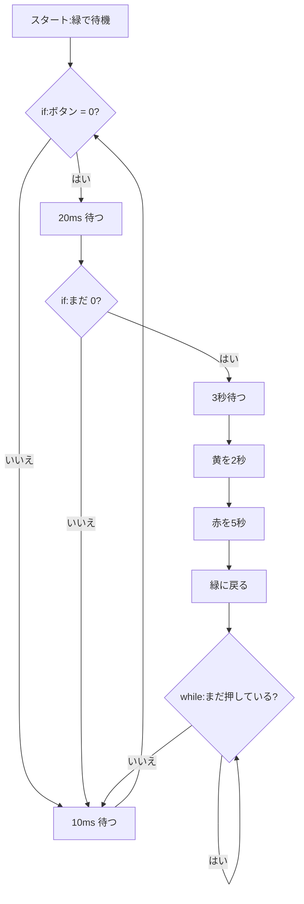

# 03. 押しボタン信号(ポーリング版)

## 🎯 このステップのゴール

- タクトスイッチの状態を GPIO の **入力** で読み取れる
- **プルアップ抵抗** が必要な理由と、「押すと 0」になるわけを説明できる
- **チャタリング** の対策ができる

## 🧰 用意するもの

| 部品 | 数 |
|---|---|
| Raspberry Pi Pico(+ USB ケーブル) | 1 |
| 信号機LEDモジュール(抵抗内蔵) | 1 |
| タクトスイッチ | 1 |
| ブレッドボード・ジャンパーワイヤ | 1式 |

## 📖 知っておきたいこと

### タクトスイッチのしくみ

**押している間だけ電気が通る** スイッチだよ。片側を GP5、もう片側を GND につなぐ。

### 何もつながっていない入力は「ふらふら」する(フローティング)

ボタンを押していないとき、GP5 は **どこにもつながっていない** 状態になる。これを **フローティング**(浮いている状態)というよ。

- HIGH か LOW か決まらず、指で触っただけで値が変わることもある。
- 線が **アンテナ** のように、まわりの電気のノイズを拾ってしまうイメージだよ。

### プルアップ抵抗とは

入力ピンを抵抗を通して 3.3V に **「引っ張り上げて(pull up)」** おく方法だよ。

```
 3.3V
  │
 [抵抗](Pico の内部にある)
  │
  ├───── GP5(入力)
  │
  ┴ スイッチ
  │
 GND
```

| ボタン | GP5 がつながる先 | 読み取る値 |
|---|---|---|
| 押していない | 抵抗を通して 3.3V | **HIGH(1)** |
| 押している | GND | **LOW(0)** |

> ⚠️ **「押すと 0」** になる点が、感覚と逆なので注意!

- Pico には **内部にプルアップ抵抗** があり、`Pin.PULL_UP` と書くだけで使える(外付け不要)。
- 抵抗があるので、押しても 3.3V と GND が **ショート(直接つながって大電流が流れること)しない** よ。

### チャタリング

スイッチは押した瞬間に、中の金属の接点が **細かく ON/OFF をくり返す**(バタつく)ことがある。これを **チャタリング** というよ。

- 対策:押されたら **少し待って(20ms)もう一度確認** する。それでも押されていたら「本当に押した」と判断する。

## 🔌 配線

| 部品の端子 | Pico の GP番号 | 物理ピン番号 |
|---|---|---|
| 信号機 赤 | GP2 | 4 |
| 信号機 黄 | GP3 | 5 |
| 信号機 緑 | GP4 | 6 |
| 信号機 GND | GND | 3 |
| タクトスイッチ 片側 | GP5 | 7 |
| タクトスイッチ もう片側 | GND | 8 |

```
Pico                     タクトスイッチ
GP5  (物理7) ─────────── ┤ 片側
GND  (物理8) ─────────── ┤ もう片側
(信号機は 02 と同じ)
```

> 配布したピン配置図で、GP番号と物理ピン番号の両方を確かめよう。
> タクトスイッチは4本足。**対角線** の足を使うと確実だよ。

## 💻 プログラム

ファイル:[button_polling.py](button_polling.py)

下のコードをコピーして Thonny に貼り付け、▶ 実行しよう。

<!-- include: button_polling.py -->
```python
# ---- 必要な道具を読み込む ----
from machine import Pin
import time

# ---- ピンの設定 ----
red    = Pin(2, Pin.OUT)   # GP2:赤(出力)
yellow = Pin(3, Pin.OUT)   # GP3:黄(出力)
green  = Pin(4, Pin.OUT)   # GP4:緑(出力)

# GP5 をボタン用の「入力(IN)」にする
# PULL_UP:内部のプルアップ抵抗を使う
#   押していない → 1(HIGH)
#   押している   → 0(LOW) ← 押すと 0 になる点に注意!
button = Pin(5, Pin.IN, Pin.PULL_UP)

# ---- 関数:全部のLEDを消す ----
def all_off():
    for p in (red, yellow, green):
        p.value(0)

# ---- スタート時の状態 ----
all_off()
green.value(1)             # 車用の信号は緑で待つ
print("待機中(緑)")

# ---- メインの繰り返し ----
while True:
    # ボタンの状態を読む。0 なら押されている
    if button.value() == 0:
        time.sleep_ms(20)              # 20ミリ秒待つ(チャタリング対策)
        if button.value() == 0:        # 20ミリ秒後もまだ押されていたら「本当に押した」と判断
            print("ボタン押下")
            time.sleep(3)              # 押してからすぐには変わらず、3秒待つ

            # 緑 → 黄
            green.value(0)
            yellow.value(1)
            print("黄")
            time.sleep(2)              # 黄は2秒

            # 黄 → 赤
            yellow.value(0)
            red.value(1)
            print("赤(歩行者OK)")
            time.sleep(5)              # 赤は5秒(この間に歩行者がわたる)

            # 赤 → 緑(元に戻る)
            red.value(0)
            green.value(1)
            print("緑に復帰")

            # ボタンが押しっぱなしなら、離されるまでここで待つ
            # (待たないと、すぐに次のサイクルが始まってしまう)
            while button.value() == 0:
                time.sleep_ms(10)

    # 10ミリ秒ごとにボタンを見に行く(これがポーリング)
    time.sleep_ms(10)
```

## 🔍 プログラムを読み解こう

- **ポーリング** =「何度も見に行って確認する」方式。最後の `time.sleep_ms(10)` で、10ミリ秒ごとにボタンを見に行っているよ。
- `button = Pin(5, Pin.IN, Pin.PULL_UP)`:GP5 を **入力** にして、内部プルアップを使う。
- **if の中に if(入れ子)**:1回目の `if` で押されたのを見つけ、20ms 待って2回目の `if` で確かめる → **チャタリング対策**。
- `while button.value() == 0:`:ボタンが **離されるまで待つ**。待たないと、押しっぱなしのとき次のサイクルがすぐ始まってしまう。



## ✅ 動作チェック

- [ ] 最初は緑が点き、Shell に「待機中(緑)」と表示された
- [ ] ボタンを押すと、3秒後に 黄 → 赤 → 緑 と変わった
- [ ] ボタンを押しっぱなしにしても、サイクルが連続で始まらない

## 🤔 考えてみよう

1. 黄や赤の最中にボタンを押すとどうなる? なぜ?

<details>
<summary>答えを見る</summary>

**まったく反応しない** よ。黄や赤の間、プログラムは `time.sleep()` で待っているので、ボタンを **見に行っていない** からだね。01 で書いた「sleep 中は他のことができない」がここで出てきたよ。
この問題は次の [04. 割り込み版](../04-button-irq/README.md) で解決するよ。

</details>

2. `Pin.PULL_UP` を書かずに `Pin(5, Pin.IN)` にするとどうなる?

<details>
<summary>答えを見る</summary>

押していないときの GP5 が **フローティング**(ふらふら)になり、押していないのに 0 になったり 1 になったりして、勝手にサイクルが始まることがあるよ。

</details>

3. `if button.value() == 0:` を `== 1` にしたらどうなる?

<details>
<summary>答えを見る</summary>

プルアップなので、**押していないとき** が 1。だから **押していないのにすぐサイクルが始まって** しまうよ。「押すと 0」をしっかり覚えよう。

</details>

## 🚀 改良チャレンジ

### レベル1:数字を変えてみよう

押してから黄になるまでの時間を **1秒** にしてみよう。

<details>
<summary>ヒントを見る</summary>

`print("ボタン押下")` のすぐ下の `time.sleep(3)` を探そう。

</details>

<details>
<summary>解答例を見る(まず自分で挑戦してから!)</summary>

[解答例と解説](answers/README.md#lv1) / [lv1.py](answers/lv1.py)

</details>

### レベル2:動きを足してみよう

ボタンを押した **回数を数えて** Shell に表示しよう(例:「ボタン押下 3 回目」)。

<details>
<summary>ヒントを見る</summary>

`while True:` の前に `count = 0` を作り、「本当に押した」と判断したところで `count = count + 1` しよう。

</details>

<details>
<summary>解答例を見る(まず自分で挑戦してから!)</summary>

[解答例と解説](answers/README.md#lv2) / [lv2.py](answers/lv2.py)

</details>

### レベル3:自分で考えて作ってみよう

ボタンを **長押し(1秒以上)** したら、**全色が点滅するモード** にしよう。短く押したら今まで通りの信号にする。

<details>
<summary>ヒントを見る</summary>

- 押されたら、`while button.value() == 0:` の中で 10ms ずつ待ちながら、押している時間を足していこう。
- 離されたあとに、その時間が 1000ms 以上かどうかを `if` で調べよう。
- 点滅モードの終わり方(もう一度押したら終わる、など)も自分で決めよう。

</details>

<details>
<summary>解答例を見る(まず自分で挑戦してから!)</summary>

[解答例と解説](answers/README.md#lv3) / [lv3.py](answers/lv3.py)

</details>

## ➡️ 次へ

[04. 押しボタン信号(割り込み版)](../04-button-irq/README.md)
