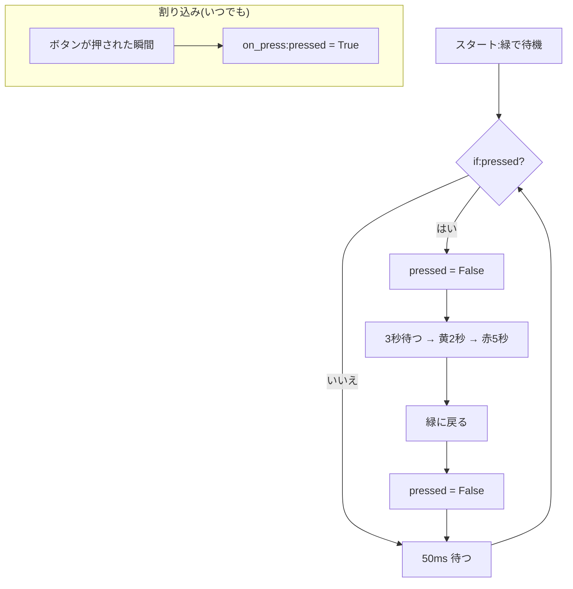

# 04. 押しボタン信号(割り込み版)

## 🎯 このステップのゴール

- **割り込み(irq)** のしくみを、ポーリングとくらべて説明できる
- **フラグ** と `global` を使って、割り込みとメインの処理をつなげられる
- 黄・赤の最中に押されたボタンにも気づけるようにする

## 🧰 用意するもの

| 部品 | 数 |
|---|---|
| Raspberry Pi Pico(+ USB ケーブル) | 1 |
| 信号機LEDモジュール(抵抗内蔵) | 1 |
| タクトスイッチ | 1 |
| ブレッドボード・ジャンパーワイヤ | 1式 |

配線は [03](../03-button-polling/README.md) と同じだよ。

## 📖 知っておきたいこと

### 割り込み(irq)とは

**「何かが起きたら知らせてもらう」** 方式だよ。

| たとえ | 方式 |
|---|---|
| 📮 郵便受けを何度も見に行く | **ポーリング**(03 のやり方) |
| 🔔 インターホンが鳴ったら出る | **割り込み**(このステップ) |

- `Pin.IRQ_FALLING`:HIGH → LOW に **変わった瞬間**(=押した瞬間)に知らせてもらう。
  (プルアップなので、押すと 1 → 0 に「落ちる(falling)」んだね)
- 割り込みで呼ばれる関数を **ハンドラ** という。ハンドラは **短く**:**フラグ(目印)を立てるだけ** にするのが大事。
- **フラグ**:「押されたよ」を覚えておくための変数(`True` / `False`)。
- `global`:関数の **外** にある変数を、関数の中で書き換えるための宣言。

### ポーリングと割り込みの比較

| | ポーリング | 割り込み(irq) |
|---|---|---|
| しくみ | 何度も見に行く | 起きたら知らせてもらう |
| sleep 中の押下 | 気づかない | フラグとして残る |
| わかりやすさ | わかりやすい | 少し難しい |

## 🔌 配線

| 部品の端子 | Pico の GP番号 | 物理ピン番号 |
|---|---|---|
| 信号機 赤 | GP2 | 4 |
| 信号機 黄 | GP3 | 5 |
| 信号機 緑 | GP4 | 6 |
| 信号機 GND | GND | 3 |
| タクトスイッチ 片側 | GP5 | 7 |
| タクトスイッチ もう片側 | GND | 8 |

> 配布したピン配置図で、GP番号と物理ピン番号の両方を確かめよう。

## 💻 プログラム

ファイル:[button_irq.py](button_irq.py)

下のコードをコピーして Thonny に貼り付け、▶ 実行しよう。

```python
# ---- 必要な道具を読み込む ----
from machine import Pin
import time

# ---- ピンの設定(ポーリング版と同じ) ----
red    = Pin(2, Pin.OUT)
yellow = Pin(3, Pin.OUT)
green  = Pin(4, Pin.OUT)
button = Pin(5, Pin.IN, Pin.PULL_UP)   # 押すと 0 になる

# ---- フラグ(目印)の変数 ----
# ボタンが押されたら True にする。最初は「押されていない」= False
pressed = False

# ---- 割り込みで呼ばれる関数(ハンドラ) ----
# ボタンが押された瞬間に、Pico が自動でこの関数を呼んでくれる
def on_press(pin):
    global pressed     # 関数の外にある pressed を書き換えるための宣言
    pressed = True     # 「押されたよ」と目印を立てるだけ(短く書くのが大事)

# ---- 割り込みの登録 ----
# IRQ_FALLING:1 → 0 に変わった瞬間(=押した瞬間)に on_press を呼ぶ
button.irq(trigger=Pin.IRQ_FALLING, handler=on_press)

# ---- 関数:全部のLEDを消す ----
def all_off():
    for p in (red, yellow, green):
        p.value(0)

# ---- スタート時の状態 ----
all_off()
green.value(1)
print("待機中(緑)")

# ---- メインの繰り返し ----
while True:
    # ボタンを直接見に行かず、目印(pressed)を確認する
    if pressed:
        pressed = False            # 目印を下ろしておく
        print("ボタン押下")
        time.sleep_ms(3000)        # 3秒待つ

        # 緑 → 黄
        green.value(0)
        yellow.value(1)
        print("黄")
        time.sleep_ms(2000)        # 黄は2秒

        # 黄 → 赤
        yellow.value(0)
        red.value(1)
        print("赤(歩行者OK)")
        time.sleep_ms(5000)        # 赤は5秒

        # 赤 → 緑
        red.value(0)
        green.value(1)
        print("緑に復帰")

        # 黄・赤の間に押されていても、割り込みで目印が立っている
        # ここで False に戻すと「その押下は無視」
        # この行を消すと「予約」として次のサイクルが始まる
        pressed = False

    time.sleep_ms(50)              # 0.05秒ごとに目印を確認
```

## 🔍 プログラムを読み解こう

- `pressed = False`:**フラグ** の変数。最初は「押されていない」。
- `def on_press(pin):`:割り込みで呼ばれる **関数(ハンドラ)**。中は2行だけ。
- `global pressed`:関数の外の `pressed` を書き換えるための宣言。これがないと、関数の中だけの別の変数になってしまう。
- `button.irq(trigger=Pin.IRQ_FALLING, handler=on_press)`:「押した瞬間に `on_press` を呼んでね」と **登録** する。
- メインの `while True:` では、ボタンを直接見ずに **`if pressed:`** でフラグを確認しているよ。
- 最後の `pressed = False`:黄・赤の間に押されたぶんを「無視」している。



## ✅ 動作チェック

- [ ] ボタンを押すと、3秒後に 黄 → 赤 → 緑 と変わった
- [ ] 黄・赤の最中に押しても、緑に戻ったあと勝手に次のサイクルは始まらない
- [ ] 03(ポーリング版)とのちがいを、比較表を見ながら説明できる

## 🤔 考えてみよう

1. 最後の `pressed = False` を消すとどうなる?

<details>
<summary>答えを見る</summary>

黄・赤の最中に押したぶんのフラグが **残ったまま** になるので、緑に戻ったあと **すぐ次のサイクルが始まる** よ。つまり「**予約**」として受け付けたことになるんだ。
ポーリング版では sleep 中の押下に気づけなかったけど、割り込み版ではフラグとして残るので、こういうことができるんだね。

</details>

2. `global pressed` を消すとどうなる?

<details>
<summary>答えを見る</summary>

`on_press` の中の `pressed = True` が、関数の中だけの **別の変数** を作るだけになって、外の `pressed` は `False` のまま。だから **ボタンを押しても何も起きない** よ。

</details>

3. ハンドラの中に `time.sleep(5)` や信号を変える処理を書かないのはなぜ?

<details>
<summary>答えを見る</summary>

割り込みは、メインの処理を **一時停止して** 割り込んで動くよ。ハンドラが長いと、その間メインの処理が止まったり、次の割り込みに対応できなくなったりする。だから **目印を立てるだけ** にして、重い処理はメインの `while` でやるんだ。

</details>

## 🚀 改良チャレンジ

### レベル1:数字を変えてみよう

赤の秒数を **8秒** にしてみよう。

<details>
<summary>ヒントを見る</summary>

このプログラムは `time.sleep_ms()` を使っているよ。8秒は何ミリ秒かな?

</details>

<details>
<summary>解答例を見る(まず自分で挑戦してから!)</summary>

[解答例と解説](answers/README.md#lv1) / [lv1.py](answers/lv1.py)

</details>

### レベル2:動きを足してみよう

赤の間にボタンが押されたら、Shell に **「予約しました」** と表示して、緑に戻ったあと次のサイクルが始まるようにしよう。

<details>
<summary>ヒントを見る</summary>

- 赤の `time.sleep_ms(5000)` を、`for` で「50ms × 100回」に分けよう。そうすると、その間に何度も `pressed` を確認できるよ。
- 予約されたかどうかを覚える変数 `reserved` を作ろう。
- 最後の `pressed = False` を、予約があったときだけ `True` にするよう変えよう。

</details>

<details>
<summary>解答例を見る(まず自分で挑戦してから!)</summary>

[解答例と解説](answers/README.md#lv2) / [lv2.py](answers/lv2.py)

</details>

### レベル3:自分で考えて作ってみよう

チャタリング対策として、**前回の押下から 200ms 以内の割り込みは無視** しよう。

<details>
<summary>ヒントを見る</summary>

- `time.ticks_ms()` は「Pico が動き始めてからのミリ秒」を返すよ。
- 前回受け付けた時刻を変数に覚えておき、`time.ticks_diff(今, 前回)` で差を計算しよう。
- ハンドラの中で使う変数が増えるので、`global` も増えるよ。

</details>

<details>
<summary>解答例を見る(まず自分で挑戦してから!)</summary>

[解答例と解説](answers/README.md#lv3) / [lv3.py](answers/lv3.py)

</details>

## ➡️ 次へ

[05. 人感センサー](../05-pir-sensor/README.md)
