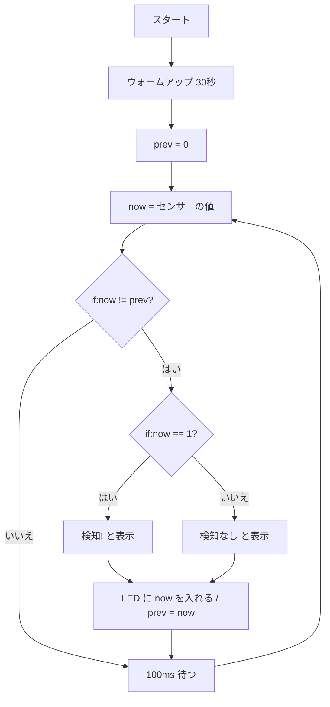

# 05. 人感センサー(SB412A)

## 🎯 このステップのゴール

- 人感センサーのしくみ(赤外線・ウォームアップ・ホールド時間)が分かる
- **プルダウン** をプルアップとくらべて説明できる
- 前回の値と今の値をくらべて、**変化したときだけ** 処理できる

## 🧰 用意するもの

| 部品 | 数 |
|---|---|
| Raspberry Pi Pico(+ USB ケーブル) | 1 |
| 人感センサー SB412A | 1 |
| ジャンパーワイヤ | 3 |

## 📖 知っておきたいこと

### 人感センサーのしくみ

- 人の体から出る **赤外線(熱)の変化** を感じ取るよ。止まっている物の熱ではなく、「変化」に反応するんだ。
- 検知すると OUT が **HIGH(1)**、いなくなると **LOW(0)** になる。
- **ウォームアップ**:電源を入れてから数十秒は不安定。プログラムでは30秒待つよ。
- **ホールド時間**:一度検知すると、人が動かなくなってもしばらく HIGH が続く。

### プルダウン(プルアップとの対比)

| | プルアップ(03・04) | プルダウン(このステップ) |
|---|---|---|
| 何もつながっていないとき | 3.3V に引っ張る → **1** | GND に引っ張る → **0** |
| 書き方 | `Pin.PULL_UP` | `Pin.PULL_DOWN` |
| 使い方 | ボタン(押すと 0) | センサー(検知すると 1) |

センサーの線が外れたりしても、フローティング(ふらふら)にならず **0 に固定** されるよ。

もっと詳しく → [電気の基本まとめ](../docs/electronics-basics.md)

## 🔌 配線

| 人感センサーの端子 | Pico の GP番号 | 物理ピン番号 |
|---|---|---|
| VCC | 3V3(OUT) | 36 |
| GND | GND | 38 |
| OUT | GP15 | 20 |

```
Pico                       人感センサー SB412A
3V3(OUT) (物理36) ──────── VCC
GND      (物理38) ──────── GND
GP15     (物理20) ──────── OUT
```

> 配布したピン配置図で、GP番号と物理ピン番号の両方を確かめよう。
> ⚠️ センサー基板の **印字** で、VCC / OUT / GND の並びを必ず確認しよう。製品によって並びがちがうことがあるよ。

## 💻 プログラム

ファイル:[pir_sensor.py](pir_sensor.py)

下のコードをコピーして Thonny に貼り付け、▶ 実行しよう。

```python
# ---- 必要な道具を読み込む ----
from machine import Pin
import time

# ---- ピンの設定 ----
# GP15 を人感センサーの入力にする
# PULL_DOWN:何もつながっていないときは 0(LOW)に固定する
pir = Pin(15, Pin.IN, Pin.PULL_DOWN)

# Pico 本体に付いているLED(GP25)を出力にする
# ※ Pico W の場合は Pin("LED", Pin.OUT) と書く
led = Pin(25, Pin.OUT)

# ---- ウォームアップ ----
# 電源を入れてすぐはセンサーが不安定なので30秒待つ
print("ウォームアップ中...")
time.sleep(30)
print("開始")

# ---- 前回の値を覚えておく変数 ----
prev = 0   # 最初は「検知なし」として始める

# ---- メインの繰り返し ----
while True:
    now = pir.value()          # 今のセンサーの値(1:検知、0:検知なし)

    # 前回と値が変わったときだけ表示する
    # (毎回表示すると Shell が文字だらけになるため)
    if now != prev:
        if now == 1:
            print("検知!")
        else:
            print("検知なし")
        led.value(now)         # 検知中は本体LEDを点ける
        prev = now             # 今の値を「前回の値」として覚える

    time.sleep_ms(100)         # 0.1秒ごとに確認
```

## 🔍 プログラムを読み解こう

- `Pin(15, Pin.IN, Pin.PULL_DOWN)`:GP15 を **入力** にして、**プルダウン**(何もないとき 0)にする。
- `time.sleep(30)`:**ウォームアップ** の30秒待ち。この間は何も表示されないけど、こわれてないよ。
- `prev`(前回の値)と `now`(今の値)をくらべて、**`if now != prev:` 変化したときだけ** 表示する。毎回表示すると Shell が文字だらけになるからね。
- **if の中に if**:変化したとき、1 なら「検知!」、0 なら「検知なし」。
- `led.value(now)`:今の値(1 か 0)をそのまま本体LEDに入れている。



## ✅ 動作チェック

- [ ] 「ウォームアップ中...」の30秒後に「開始」と表示された
- [ ] センサーの前で手を動かすと「検知!」と表示され、本体LEDが点いた
- [ ] しばらくじっとしていると「検知なし」と表示され、LEDが消えた

## 🤔 考えてみよう

1. 手を動かすのをやめても、すぐ「検知なし」にならないのはなぜ?

<details>
<summary>答えを見る</summary>

センサーの **ホールド時間** だよ。一度検知すると、しばらく HIGH が続くようになっているんだ。

</details>

2. `if now != prev:` をなくして、毎回 `print` するとどうなる?

<details>
<summary>答えを見る</summary>

0.1秒ごとに「検知!」や「検知なし」が表示され続けて、Shell が文字だらけになるよ。「**変化したときだけ**」処理する考え方は、いろいろなセンサーで使えるよ。

</details>

3. `prev = now` の行を消すとどうなる?

<details>
<summary>答えを見る</summary>

`prev` がずっと 0 のままなので、検知している間(now = 1)は **毎回「変化した」と判断** されて、「検知!」が表示され続けるよ。

</details>

## 🚀 改良チャレンジ

### レベル1:数字を変えてみよう

ウォームアップ時間を **10秒** にしてみよう。残り秒数を表示できるとさらにいいね。

<details>
<summary>ヒントを見る</summary>

`time.sleep(30)` を変えよう。残り秒数は `for i in range(10, 0, -1):` で 10, 9, … 1 と数を減らせるよ。

</details>

<details>
<summary>解答例を見る(まず自分で挑戦してから!)</summary>

[解答例と解説](answers/README.md#lv1) / [lv1.py](answers/lv1.py)

</details>

### レベル2:動きを足してみよう

**検知した回数** を数えて表示しよう(例:「検知! 3 回目」)。

<details>
<summary>ヒントを見る</summary>

数えるのは「0 → 1 に変わったとき」だけ。`if now == 1:` の中で数えよう。

</details>

<details>
<summary>解答例を見る(まず自分で挑戦してから!)</summary>

[解答例と解説](answers/README.md#lv2) / [lv2.py](answers/lv2.py)

</details>

### レベル3:自分で考えて作ってみよう

人を検知したら **信号機を赤**、いなくなったら **緑** にしよう([02](../02-traffic-light/README.md) と組み合わせ)。

<details>
<summary>ヒントを見る</summary>

- 02 のピン設定(GP2・GP3・GP4)と `all_off()` をコピーしてこよう。
- 信号機の配線も 02 と同じだよ。GND は物理3番を使えば、人感センサーの GND(物理38番)とぶつからないよ。
- 「本体LEDを点ける」ところを「信号機の色を変える」にしよう。

</details>

<details>
<summary>解答例を見る(まず自分で挑戦してから!)</summary>

[解答例と解説](answers/README.md#lv3) / [lv3.py](answers/lv3.py)

</details>

## ➡️ 次へ

[06. 超音波センサー](../06-ultrasonic/README.md)
