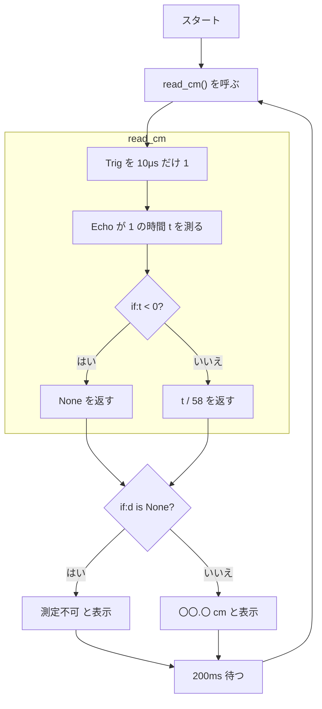

# 06. 超音波センサー(HC-SR04)

## 🎯 このステップのゴール

- 音の速さと時間から **距離を計算** できる(`t / 58` の意味が分かる)
- 5V と 3.3V の問題と、**分圧回路** で電圧を下げる方法を説明できる
- 関数 `read_cm()` で距離を測って cm で表示できる

## 🧰 用意するもの

| 部品 | 数 |
|---|---|
| Raspberry Pi Pico(+ USB ケーブル) | 1 |
| 超音波センサー HC-SR04 | 1 |
| 抵抗 1kΩ | 1 |
| 抵抗 2kΩ | 1 |
| ブレッドボード・ジャンパーワイヤ | 1式 |

## 📖 知っておきたいこと

### 超音波センサーのしくみ

- 人には聞こえない高い音(**40kHz**)を出して、物に当たって **返ってくるまでの時間** を測るよ。
- コウモリやイルカと同じ考え方だね。

```
 センサー ──(音)──▶ 物体
 センサー ◀──(反射)── 物体
```

- **Trig**:「音を出して!」の合図を送る端子
- **Echo**:音が返ってくるまでの時間だけ HIGH になる端子

### 音の速さから距離を求める

音速は約 **340m/秒**(気温15℃付近。正確には **331.5 + 0.6 × 気温**)。

**① 単位をそろえる**(μs = 100万分の1秒)

| 段階 | 内容 |
|---|---|
| 式 | m/秒 → cm/秒 → cm/μs |
| 数値を入れる | 340m/秒 = 34000cm/秒 = 34000 ÷ 1000000 cm/μs |
| 答え | **0.034cm/μs** |

**② 距離を求める**

距離 = 速さ × 時間。ただし音は **行って帰ってくる(往復)** ので、**2で割る** よ。

| 段階 | 内容 |
|---|---|
| 式 | 距離(cm)= 時間(μs)× 0.034 ÷ 2 |
| 数値を入れる | = 時間 × 0.017 = 時間 ÷ 58.8… |
| 答え | **距離 ≒ 時間 ÷ 58** ← コードの `t / 58` はこれ! |

**③ 例:Echo が 580μs だったら**

| 段階 | 内容 |
|---|---|
| 式 | 距離 = 時間 ÷ 58 |
| 数値を入れる | 580 ÷ 58 |
| 答え | **10cm** |

### 5V と 3.3V の問題

- HC-SR04 は **5V** で動き、Echo から **5V** の信号が出てくる。
- Pico の入力は **3.3V まで**。5V をそのまま入れると **壊れるおそれ** があるよ。
- → 電圧を下げる **分圧回路** を使おう。

### 抵抗で電圧を分ける(分圧)

抵抗を直列に2つつなぐと、電圧は **抵抗の大きさに比例して分かれる** よ。

| 段階 | 内容 |
|---|---|
| 式 | 出力電圧 = 入力電圧 × R2 ÷(R1 + R2) |
| 数値を入れる | 5V × 2kΩ ÷(1kΩ + 2kΩ)= 5 × 2/3 |
| 答え | ≒ **3.3V** |

```
Echo ──[1kΩ]──┬── GP11
              │
            [2kΩ]
              │
             GND
```

- たとえ:水の流れを2つの坂に分けると、途中の高さは坂の長さで決まる。
- **Trig** は Pico から出す 3.3V の信号で動くので、**直結で OK**。
- **3.3V 対応品(HC-SR04P など)** なら、分圧は不要だよ。

もっと詳しく → [電気の基本まとめ](../docs/electronics-basics.md)

## 🔌 配線

| 超音波センサーの端子 | Pico の GP番号 | 物理ピン番号 |
|---|---|---|
| VCC | VBUS(5V) | 40 |
| GND | GND | 38 |
| Trig | GP10 | 14 |
| Echo | 分圧回路経由で GP11 | 15 |

```
Pico                          HC-SR04
VBUS(5V) (物理40) ─────────── VCC
GND      (物理38) ─────────── GND
GP10     (物理14) ─────────── Trig
GP11     (物理15) ──┬──[1kΩ]── Echo
                    │
                  [2kΩ]
                    │
                   GND
```

> 配布したピン配置図で、GP番号と物理ピン番号の両方を確かめよう。
> ⚠️ **1kΩ と 2kΩ の位置を逆にしない!** Echo 側が 1kΩ、GND 側が 2kΩ だよ。逆にすると約 1.7V になって、うまく読めないことがあるよ。

## 💻 プログラム

ファイル:[ultrasonic.py](ultrasonic.py)

下のコードをコピーして Thonny に貼り付け、▶ 実行しよう。

```python
# ---- 必要な道具を読み込む ----
# time_pulse_us:ピンが HIGH になっている時間を μs(100万分の1秒)単位で測る道具
from machine import Pin, time_pulse_us
import time

# ---- ピンの設定 ----
trig = Pin(10, Pin.OUT)   # GP10:Trig(音を出す合図を送る → 出力)
echo = Pin(11, Pin.IN)    # GP11:Echo(返ってきた時間を受け取る → 入力)
                          # ※ Echo は分圧回路(1kΩ・2kΩ)を通してつなぐ

# ---- 関数:距離を測って cm で返す ----
def read_cm():
    # 合図の前に、いったん 0 にして落ち着かせる
    trig.value(0)
    time.sleep_us(2)

    # 10μs だけ 1 にする → センサーが超音波を出す
    trig.value(1)
    time.sleep_us(10)
    trig.value(0)

    # Echo が 1 になっている時間(音が往復した時間)を測る
    # 30000μs(=30ミリ秒)待っても返ってこなければあきらめる
    t = time_pulse_us(echo, 1, 30000)

    # 測れなかったとき、t はマイナスの値になる
    if t < 0:
        return None        # None =「値なし」を返す

    # 時間(μs)を距離(cm)に変える
    # 音速 0.034cm/μs × 時間 ÷ 2(往復なので)≒ 時間 ÷ 58
    return t / 58

# ---- メインの繰り返し ----
while True:
    d = read_cm()          # 距離を測る

    if d is None:
        print("測定不可")
    else:
        # {:.1f} は「小数第1位まで表示する」という意味
        print("{:.1f} cm".format(d))

    time.sleep_ms(200)     # 0.2秒ごとに測る
```

## 🔍 プログラムを読み解こう

- `def read_cm():`:距離を測る処理を **関数** にまとめ、**`return`** で cm を返す。
- Trig を **10μs だけ HIGH** にする =「音を出して!」の合図。その前に 0 にして落ち着かせている。
- `time_pulse_us(echo, 1, 30000)`:Echo が HIGH(1)の時間を μs で測る。**30ms 以上はあきらめる**(タイムアウト)。
- **`if t < 0: return None`**:測れなかったときは「値なし(None)」を返す。
- `return t / 58`:上で計算した式だよ。
- メインの **`if d is None:`** で、測れなかったときと測れたときを分けている。
- 測定範囲は約 **2〜400cm**。近すぎる・斜めの面・やわらかい物(布など)は苦手だよ。



## ✅ 動作チェック

- [ ] 0.2秒ごとに距離が表示された
- [ ] 手を近づけると数字が小さく、遠ざけると大きくなった
- [ ] 定規で 10cm の位置に物を置いたとき、だいたい 10cm と表示された

## 🤔 考えてみよう

1. なぜ 2 で割るの?

<details>
<summary>答えを見る</summary>

Echo が HIGH の時間は、音が **センサー → 物 → センサー** と **往復** した時間だからだよ。測りたいのは片道の距離なので、2で割るんだ。

</details>

2. Echo を分圧せず、直接 GP11 につなぐと何が起きる?

<details>
<summary>答えを見る</summary>

Pico の入力に **5V** が入ってしまうよ。Pico の入力は 3.3V までなので、**Pico が壊れるおそれ** がある。すぐには壊れなくても、少しずつ傷むこともあるので、絶対にやめよう。

</details>

3. 気温が 35℃ の日は、音速は何 m/秒?

<details>
<summary>答えを見る</summary>

- 式:331.5 + 0.6 × 気温
- 数値を入れる:331.5 + 0.6 × 35 = 331.5 + 21
- 答え:**352.5m/秒**

暑い日は音が速くなるので、同じ時間でも実際の距離は少し長くなるよ。

</details>

## 🚀 改良チャレンジ

### レベル1:数字を変えてみよう

測る間隔を **1秒ごと** にしてみよう。

<details>
<summary>ヒントを見る</summary>

最後の `time.sleep_ms(200)` を変えよう。1秒は何ミリ秒かな?

</details>

<details>
<summary>解答例を見る(まず自分で挑戦してから!)</summary>

[解答例と解説](answers/README.md#lv1) / [lv1.py](answers/lv1.py)

</details>

### レベル2:動きを足してみよう

**気温を変数** にして、音速を計算し直そう(`t / 58` のかわりに使う)。

<details>
<summary>ヒントを見る</summary>

- 音速(m/秒)= 331.5 + 0.6 × 気温
- m/秒 を cm/μs にするには、× 100 ÷ 1000000。
- 距離 = 時間 × 音速(cm/μs)÷ 2

</details>

<details>
<summary>解答例を見る(まず自分で挑戦してから!)</summary>

[解答例と解説](answers/README.md#lv2) / [lv2.py](answers/lv2.py)

</details>

### レベル3:自分で考えて作ってみよう

**5回測った平均** を表示して、値のブレを減らそう。

<details>
<summary>ヒントを見る</summary>

- `read_avg(n)` のような関数を作って、`for` で n 回 `read_cm()` を呼ぼう。
- `None`(測定不可)のときは足さないようにしよう。何回うまく測れたかも数えておくと、正しい平均が出せるよ。

</details>

<details>
<summary>解答例を見る(まず自分で挑戦してから!)</summary>

[解答例と解説](answers/README.md#lv3) / [lv3.py](answers/lv3.py)

</details>

## ➡️ 次へ

[07. チャレンジ課題](../07-challenge/README.md)
