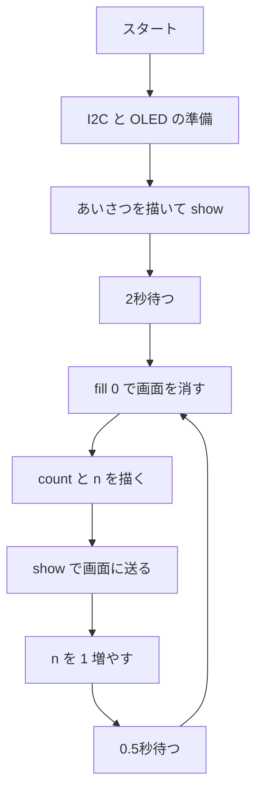

# 08. OLED ディスプレイ(SSD1306)

## 🎯 このステップのゴール

- **I2C**(2本の線でやりとりするしくみ)で部品をつなげる
- Thonny で **ライブラリ** をインストールして使える
- OLED に文字・図形・センサーの値を表示できる

## 🧰 用意するもの

| 部品 | 数 |
|---|---|
| Raspberry Pi Pico(+ USB ケーブル) | 1 |
| OLED ディスプレイ SSD1306(0.96インチ・128×64・I2C・4ピン) | 1 |
| ブレッドボード・ジャンパーワイヤ | 1式 |

## 📖 知っておきたいこと

### OLED ディスプレイって?

- OLED(有機EL)は、**1つ1つの点(ドット)が自分で光る** 画面だよ。
- 今回の画面は **横128 × 縦64 ドット**。左上が (0, 0) で、右へ x、下へ y が増えるよ。

```
(0,0) ────────────▶ x (0〜127)
  │
  │
  ▼
  y (0〜63)
```

- 標準の文字は **1文字 8×8 ドット**。1行に 128 ÷ 8 = **16文字**、64 ÷ 8 = **8行** まで書けるよ。
- 文字は **英数字だけ**(日本語はそのままでは出せない)。

### I2C(アイ・スクエア・シー)

- **SDA**(データ)と **SCL**(タイミングの合図)の **2本の線** で、たくさんの部品とやりとりできるしくみだよ。
- 部品ごとに **アドレス**(住所)があって、SSD1306 はふつう **0x3C**(10進数で **60**)。
- `i2c.scan()` で、つながっている部品のアドレスを調べられるよ。

### ライブラリのインストール(Thonny)

1. Pico をつないだ状態で、メニューの **ツール → パッケージを管理…** を開く
2. `ssd1306` で検索して、**micropython-ssd1306** を選び **インストール**
3. Pico の中に `lib/ssd1306.py` ができていれば OK

> うまくいかないときは、[ssd1306.py](https://github.com/micropython/micropython-lib/blob/master/micropython/drivers/display/ssd1306/ssd1306.py) を Thonny で開き、**Pico に `ssd1306.py` という名前で保存** してもいいよ。

### 「書いて → show()」のしくみ

- `oled.text()` や `oled.rect()` は、Pico の中の **下書き** に描くだけ。
- **`oled.show()`** を呼んだときに、はじめて画面に送られるよ。
- たとえ:黒板に書く前に、ノートに下書きしてから一気に写す感じ。

## 🔌 配線

| OLED の端子 | Pico の GP番号 | 物理ピン番号 |
|---|---|---|
| GND | GND | 23 |
| VCC | 3V3(OUT) | 36 |
| SCL | GP19 | 25 |
| SDA | GP18 | 24 |

```
Pico                      OLED (SSD1306)
GND       (物理23) ─────── GND
3V3(OUT)  (物理36) ─────── VCC
GP19      (物理25) ─────── SCL
GP18      (物理24) ─────── SDA
```

> 配布したピン配置図で、GP番号と物理ピン番号の両方を確かめよう。
> ⚠️ **VCC は 3V3(物理36)につなごう。** 端子の並び(GND・VCC の順番)は製品によってちがうので、OLED に書いてある文字を必ず見てね。
> 信号機(GP2〜4)やボタン(GP5)とピンが重ならないように、**I2C1(GP18・GP19)** を使っているよ。

## 💻 プログラム

ファイル:[oled.py](oled.py)

下のコードをコピーして Thonny に貼り付け、▶ 実行しよう。

<!-- include: oled.py -->
```python
# ---- 必要な道具を読み込む ----
# I2C:2本の線(SDA・SCL)で部品とやりとりするしくみ
from machine import Pin, I2C
import ssd1306            # OLED(SSD1306)を動かすライブラリ(Thonny で入れておく)
import time

# ---- I2C と OLED の設定 ----
i2c = I2C(1, sda=Pin(18), scl=Pin(19), freq=400000)   # I2C1:SDA=GP18、SCL=GP19
print("見つかった部品:", i2c.scan())   # [60] と出れば OK(60 = 0x3C)

oled = ssd1306.SSD1306_I2C(128, 64, i2c)   # 横128 × 縦64 ドットの画面

# ---- 最初のあいさつ ----
oled.fill(0)                      # 画面を全部消す(0 = 黒)
oled.text("Hello Pico!", 0, 0)    # 文字, x(横), y(縦)
oled.text("SSD1306 OLED", 0, 16)
oled.rect(0, 40, 128, 20, 1)      # 四角の枠:x, y, 幅, 高さ, 色(1 = 白)
oled.show()                       # ← show() を呼んで、はじめて画面に出る
time.sleep(2)

# ---- メインの繰り返し:数を数えて表示 ----
n = 0
while True:
    oled.fill(0)                  # 前の表示を消す
    oled.text("count:", 0, 0)
    oled.text(str(n), 0, 16)      # 数は str() で文字に変えてから表示
    oled.show()
    n = n + 1
    time.sleep_ms(500)            # 0.5秒ごとに数える
```

## 🔍 プログラムを読み解こう

- `I2C(1, sda=Pin(18), scl=Pin(19), freq=400000)`:**I2C1** を GP18・GP19 で使う。`freq` は通信の速さ(400kHz)。
- `i2c.scan()`:見つかった部品のアドレスを表示。**`[60]`** なら OLED が見えている。**`[]`** なら配線を確認しよう。
- `ssd1306.SSD1306_I2C(128, 64, i2c)`:画面の大きさを伝えて、OLED を使う準備をする。
- `oled.fill(0)`:画面を **全部消す**(0 = 黒、1 = 白)。
- `oled.text("文字", x, y)`:文字を描く。`oled.rect(x, y, 幅, 高さ, 1)`:四角の枠を描く。
- **`oled.show()`**:下書きを画面に送る。これを忘れると何も出ないよ!
- `str(n)`:**数を文字に変える**。`oled.text()` には文字しか渡せないからね。
- **`while True:`** の中で「消す → 描く → show()」をくり返して、表示を書きかえている。



## ✅ 動作チェック

- [ ] シェルに `見つかった部品: [60]` と表示された
- [ ] 画面に `Hello Pico!` と枠が表示された
- [ ] 2秒後に、数字が 0.5秒ごとに増えていった

## 🤔 考えてみよう

1. `oled.show()` を消したら、どうなる?

<details>
<summary>答えを見る</summary>

画面は **何も変わらない** よ。`text()` や `rect()` は下書きに描くだけで、`show()` を呼んだときにはじめて画面に送られるからね。

</details>

2. ループの最初の `oled.fill(0)` を消したら、どうなる?

<details>
<summary>答えを見る</summary>

前の数字が消えないまま **上に重ねて描かれる** ので、数字がつぶれて読めなくなるよ。表示を書きかえるときは「消してから描く」のが基本だね。

</details>

3. 1行に何文字まで書ける? 何行まで書ける?

<details>
<summary>答えを見る</summary>

- 式:画面の幅 ÷ 1文字の幅、画面の高さ ÷ 1文字の高さ
- 数値を入れる:128 ÷ 8、64 ÷ 8
- 答え:**1行16文字、8行まで**

</details>

## 🚀 改良チャレンジ

### レベル1:数字を変えてみよう

あいさつを **自分の名前** にして、画面の **まん中あたり** に表示しよう。

<details>
<summary>ヒントを見る</summary>

- `oled.text("文字", x, y)` の x と y を変えよう。
- 画面は 128×64。まん中は (64, 32) あたりだね。文字の長さの分だけ左にずらすと、まん中に見えるよ。

</details>

<details>
<summary>解答例を見る(まず自分で挑戦してから!)</summary>

[解答例と解説](answers/README.md#lv1) / [lv1.py](answers/lv1.py)

</details>

### レベル2:動きを足してみよう

**ボタン([03](../03-button-polling/README.md))を押した回数** を表示しよう。

<details>
<summary>ヒントを見る</summary>

- ボタンは GP5・プルアップ。押すと 0 だったね。
- 「前は 1、今は 0」のときだけ数えると、押しっぱなしで増え続けないよ(05 の `prev` と `now` と同じ考え方)。
- 回数が変わったときだけ画面を書きかえよう。

</details>

<details>
<summary>解答例を見る(まず自分で挑戦してから!)</summary>

[解答例と解説](answers/README.md#lv2) / [lv2.py](answers/lv2.py)

</details>

### レベル3:自分で考えて作ってみよう

**超音波センサー([06](../06-ultrasonic/README.md))の距離** を、数字と **バー(棒グラフ)** で表示しよう。

<details>
<summary>ヒントを見る</summary>

- 06 の `read_cm()` をそのままコピーしよう。
- `oled.fill_rect(x, y, 幅, 高さ, 1)` で、ぬりつぶした四角が描けるよ。
- 「50cm でバーが 128 ドット」にするなら、幅 = 距離 ÷ 50 × 128。はみ出さないように 128 で止めよう。

</details>

<details>
<summary>解答例を見る(まず自分で挑戦してから!)</summary>

[解答例と解説](answers/README.md#lv3) / [lv3.py](answers/lv3.py)

</details>

## ➡️ 次へ

もう一度 [07. チャレンジ課題](../07-challenge/README.md) にもどって、**結果を OLED に表示** するようにしてみよう!
[トップに戻る](../README.md)
